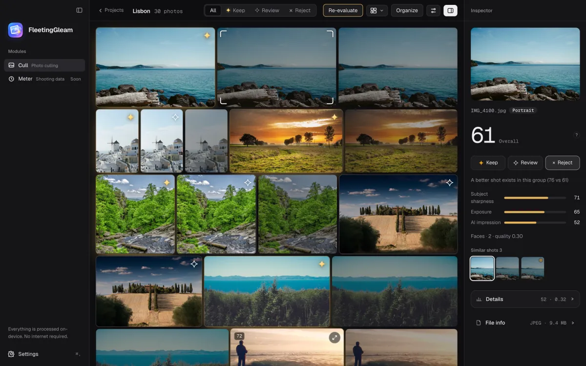

**English** | [简体中文](README.zh-CN.md)

# FleetingGleam

**A local-first photo culling app for macOS.** It groups the bursts in thousands of photos, picks the best frame in each group and shows you why. Your photos never leave your computer.

<p align="center">
  
</p>

## What it does

- **Groups your bursts.** Frames of the same moment sit together. Faces, orientation and the time gap between shots all count.
- **Picks the best frame.** Every photo gets a score and the best of each group is marked with a gold star. The inspector on the right lists where the score came from: sharpness, exposure, AI impression, faces and more.
- **Compare and decide.** Zoom into the frames of one group side by side, then press `P` to keep, `R` to review, `X` to reject, and `⌘Z` to undo.
- **Scores by kind of scene.** Portraits are judged by faces, sport by focus, and a night shot is not marked down for being dark.
- **Find photos by describing them.** Type "a small boat by the sea" or "two people". English and Chinese both work.
- **Learns your taste.** Point it at a folder of photos you picked in the past and it learns your preferences. Keep one style for weddings and another for street.
- **Organise.** Keepers move to a new folder and the rest go to the Trash, where they can be recovered.

> **A score is a hint, not a verdict.** The scoring constants are tuned by hand and have not yet been calibrated against real human labels. The app can tell you which frame is technically stronger, but a good photograph is sometimes imperfect. The final call is always yours.

## Privacy

- Photos are processed on your computer and **never uploaded**. There is no account.
- The only thing the app does on the network is **download the model files it needs**, the first time a feature uses them. After that it works fully offline.
- The models are large, so they are neither in this repository nor in the installer. They are downloaded straight from public sources such as Hugging Face, and every file is checked against a SHA-256 built into the app. Where each file comes from is listed in [docs/MODELS.md](docs/MODELS.md); how it looks to a user is in the [getting started guide](docs/GETTING_STARTED.md#第一次使用先下载模型) (Chinese).

## Quick start

### Using the app

Download the `.dmg` from [Releases](../../releases): pick `aarch64` for Apple Silicon (M-series) or `x64` for Intel. It needs **macOS 15 or later**. Step by step instructions are in the [getting started guide](docs/GETTING_STARTED.md) (Chinese).

A Windows version is planned and does not exist yet.

### Developing

You need: macOS 15+, the Xcode command line tools (for `swiftc`), [Rust](https://rustup.rs) stable, Node.js 22 and pnpm 11 (the exact version is pinned by `packageManager` in the root `package.json`).

```bash
pnpm install

pnpm dev:web        # landing page, http://localhost:3150 (English at /, Chinese at /zh)
pnpm dev:desktop    # desktop app (tauri dev); compiles Rust and Swift, slow the first time
```

Only want to work on the interface, without compiling Rust or downloading models? The desktop app has a browser preview mode that uses drawn sample photos and a simulated analysis:

```bash
pnpm desktop dev    # then open http://localhost:1420/?mock
```

The Apple Vision helper for macOS (optional; the app runs without it) has to be built once:

```bash
sh apps/desktop/scripts/build-vision.sh
```

More about developing and the checks to run before you commit: [CONTRIBUTING.md](CONTRIBUTING.md) (Chinese).

## Repository layout

```
apps/
  desktop/        Tauri 2 + React + Rust desktop app (macOS first)
    src/          the interface (TypeScript / React)
    src-tauri/    the Rust backend; native/ and vision/ hold the macOS parts written in Swift
  web/            landing page (TanStack Start + Tailwind v4 + Motion), in English and Chinese
packages/         shared types, later
docs/             documentation, see the table below
branding/         logo and icon sources
DESIGN.md         the design system: colour, type and motion rules
```

## Documentation

Most of the documentation is written in Chinese for now. Issues and pull requests in English are welcome.

| Document | What is in it |
|---|---|
| [Getting started](docs/GETTING_STARTED.md) (Chinese) | Install, the first model download, and the whole flow from import to organising |
| [CONTRIBUTING.md](CONTRIBUTING.md) (Chinese) | Contributing: environment, checks, conventions |
| [docs/RELEASING.md](docs/RELEASING.md) (Chinese) | How to publish a version and how the GitHub Actions work |
| [docs/THIRD_PARTY.md](docs/THIRD_PARTY.md) (Chinese) | The third-party models and libraries we use, and their licenses |
| [docs/MODELS.md](docs/MODELS.md) (Chinese) | Where every model file is downloaded from, its size and license, and how it is verified |
| [docs/RESEARCH.md](docs/RESEARCH.md) (Chinese) | Research notes on culling methods and models |
| [DESIGN.md](DESIGN.md) | The design system |
| [CHANGELOG.md](CHANGELOG.md) (Chinese) | Release notes |
| [SECURITY.md](SECURITY.md) (Chinese) | How to report a security problem |

## License

The source code of this project is released under the **[GNU Affero General Public License, version 3 or later (AGPL-3.0-or-later)](LICENSE)**.

- You are free to use, study, modify and share it. If you distribute a modified version, or offer it to others as a network service, you must make the corresponding source code available under the same license.
- **Not covered by this license:**
  - The names "FleetingGleam" and "惊鸿", and the logo and icons in `branding/`. Please do not use them to suggest that your derivative is the official one.
  - The sample photos in the landing page screenshots come from [Lorem Picsum](https://picsum.photos) under the Unsplash license and are not part of this project.
  - The models the app uses each have their own license, see [docs/THIRD_PARTY.md](docs/THIRD_PARTY.md).

## Contributing

Issues and pull requests are welcome, in English or Chinese. Please read [CONTRIBUTING.md](CONTRIBUTING.md) and the [code of conduct](CODE_OF_CONDUCT.md) first.
