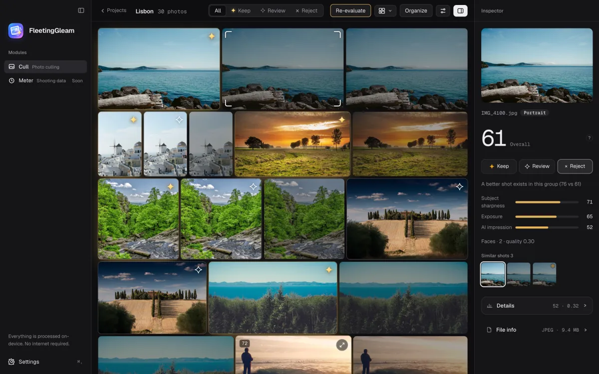

[English](README.md) | **简体中文**

# FleetingGleam（惊鸿）

**一款在你自己电脑上运行的照片筛选软件。** 把几千张照片里同一瞬间的连拍分好组，挑出每组最好的一张，并告诉你为什么。照片不会离开你的电脑。

<p align="center">
  
</p>

## 它能做什么

- **连拍自动分组**：同一瞬间的几张照片排在一起，人脸、方向、拍摄间隔都会参与判断。
- **挑出最好的一张**：给每张照片打分，同组里最好的一张会被标上金色星标；分数怎么来的，右侧检查器里逐项列出（清晰度、曝光、AI 观感、人脸……）。
- **对比和决定**：把同组的几张放大对比，用键盘 `P` 保留、`R` 待定、`X` 淘汰，`⌘Z` 撤销。
- **按场景加权**：人像看人脸，运动看对焦，夜景不会因为暗而被扣分。
- **用文字找照片**：输入“海边的小船”“两个人”，中英文都可以。
- **学习你的口味**：指向一个你过去挑好的文件夹，它会学着你的偏好，还可以为婚礼、街拍分别建立不同的风格。
- **直接用 NAS。** 在设置里添加 NAS（服务器地址和账号，SMB），应用用内置的 SMB 客户端自己连接（不经过访达，桌面上不出现挂载卷），新建项目时在应用里从共享开始逐级选文件夹；照片会先复制到应用的缓存里再分析。
- **喜好云备份。** 应用设置和学到的喜好可以自动备份到你自己的 Cloudflare R2 桶，换电脑后一键恢复。
- **带走你的口味。** 设置和每个风格学到的内容可以导出成一个文件（只有向量和决定，不含照片与路径），在另一台电脑上导入。
- **整理**：把保留的照片移到新文件夹，其余的放进废纸篓（可恢复）。

> **评分只是参考，不是裁决。** 目前的评分常数是手工调的，还没有用真实的人工标注校准，它能告诉你哪一张在技术上更强，但一张好照片有时恰恰不完美。最终的取舍始终由你决定。

## 隐私

- 照片只在本机处理，**不会上传**，也没有账号。
- 应用唯一会联网做的事，是**按需下载分析用的模型文件**（第一次用到某项功能时才下载，之后完全离线）。
- 模型文件很大，不放在本仓库里，也不随安装包分发；它们直接从 Hugging Face 等公开上游下载，每个文件的来源和校验值见 [docs/MODELS.md](docs/MODELS.md)，使用方式见 [新手上手指南](docs/GETTING_STARTED.md#第一次使用先下载模型)。

## 快速开始

### 使用

在 [Releases](../../releases) 下载 `.dmg`。需要 **Apple Silicon（M 系列）的 Mac 和 macOS 15 及以上**，Intel Mac 暂不支持。这个版本没有经过苹果公证，第一次打开前在“终端”执行一次：

```bash
xattr -cr /Applications/FleetingGleam.app
```

详细步骤见 [新手上手指南](docs/GETTING_STARTED.md)。Windows 版本在计划中，目前还没有。

### 开发

需要：macOS 15+、Xcode 命令行工具（提供 `swiftc`）、[Rust](https://rustup.rs) stable、Node.js 22、pnpm 11（版本由根目录 `package.json` 的 `packageManager` 指定）。

```bash
pnpm install

pnpm dev:web        # 落地页，http://localhost:3150（英文在 /，中文在 /zh）
pnpm dev:desktop    # 桌面应用（tauri dev），会编译 Rust 和 Swift，第一次比较慢
```

只想改界面、不想编译 Rust 或下载模型？桌面应用有一个浏览器预览模式，用绘制出来的示例照片和模拟的分析过程：

```bash
pnpm desktop dev    # 然后打开 http://localhost:1420/?mock
```

macOS 上的 Apple Vision 辅助程序（可选，没有它应用也能运行）需要先构建一次：

```bash
sh apps/desktop/scripts/build-vision.sh
```

更多开发说明、提交前要跑的检查，见 [CONTRIBUTING.md](CONTRIBUTING.md)。

## 仓库结构

```
apps/
  desktop/        Tauri 2 + React + Rust 桌面应用（macOS 优先）
    src/          前端界面（TypeScript / React）
    src-tauri/    Rust 后端；native/ 与 vision/ 是 Swift 写的 macOS 原生部分
  web/            落地页（TanStack Start + Tailwind v4 + Motion），中英双语
packages/         以后放前后端共用的类型
docs/             文档，见下表
branding/         Logo 与图标源文件
DESIGN.md         设计系统：配色、字体、动效规范
```

## 文档

| 文档 | 内容 |
|---|---|
| [新手上手指南](docs/GETTING_STARTED.md) | 安装、第一次下载模型、从导入到整理的完整流程 |
| [CONTRIBUTING.md](CONTRIBUTING.md) | 参与开发：环境、检查、约定 |
| [docs/RELEASING.md](docs/RELEASING.md) | 如何发布一个版本、GitHub Actions 怎么用 |
| [docs/THIRD_PARTY.md](docs/THIRD_PARTY.md) | 用到的第三方模型和库及其许可 |
| [docs/MODELS.md](docs/MODELS.md) | 每个模型文件从哪里下载、多大、什么许可，怎么校验 |
| [docs/RESEARCH.md](docs/RESEARCH.md) | 选片方法与模型的调研笔记（含美学模型调研） |
| [docs/REVIEW-2026-10-20.md](docs/REVIEW-2026-10-20.md) | 桌面端代码审查：按优先级列出的改进清单 |
| [docs/REVIEW-2026-10-21.md](docs/REVIEW-2026-10-21.md) | 第二轮审查：后端、前端、落地页与 CI |
| [docs/ROADMAP.md](docs/ROADMAP.md) | 路线图：先完善 macOS 端，再做 Android 端 |
| [DESIGN.md](DESIGN.md) | 设计系统（英文） |
| [CHANGELOG.md](CHANGELOG.md) | 版本更新记录 |
| [SECURITY.md](SECURITY.md) | 如何报告安全问题 |

## 许可证

本项目的源代码以 **[GNU Affero 通用公共许可证 第 3 版或更高版本（AGPL-3.0-or-later）](LICENSE)** 发布。

- 你可以自由使用、研究、修改和分享它；如果你修改后分发，或者把它作为网络服务提供给别人，需要按同一许可证公开对应的源代码。
- **不在这个许可证范围内的内容**：
  - “FleetingGleam”“惊鸿”这个名称和 `branding/` 里的 Logo、图标，请不要用它们来暗示你的衍生版本是官方版本。
  - 落地页截图和示例里的照片来自 [Lorem Picsum](https://picsum.photos)，遵循 Unsplash 授权，不属于本项目。
  - 应用使用的模型各有各的许可，见 [docs/THIRD_PARTY.md](docs/THIRD_PARTY.md)。

## 参与

欢迎提 Issue 和 Pull Request，中文或英文都可以。动手之前请先看 [CONTRIBUTING.md](CONTRIBUTING.md) 和 [行为准则](CODE_OF_CONDUCT.md)。
