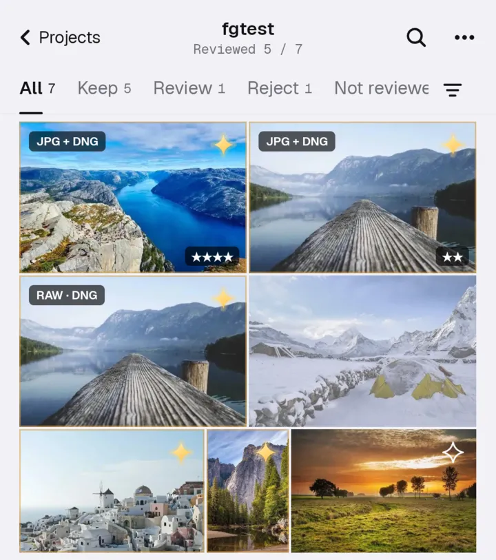
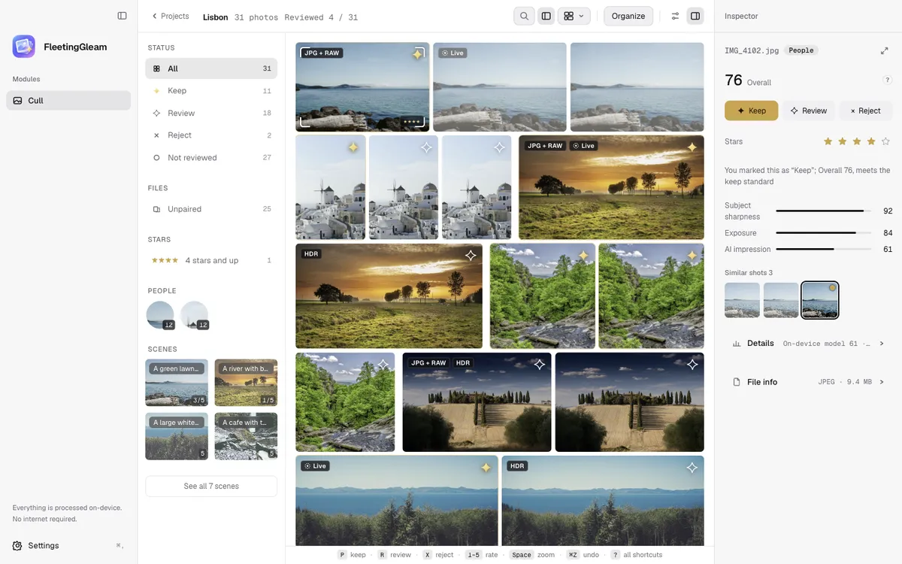
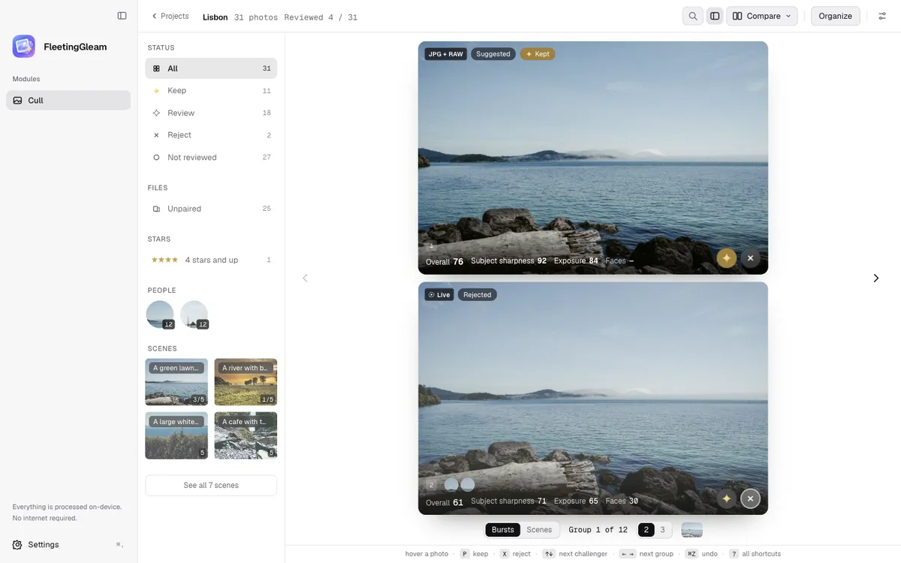

The first public release, for Mac and Android.

### Now on Android

The same analysis core as the Mac, so groups, scenes and picks match on both. On Qualcomm phones CLIP runs on the NPU. Kept photos export to your gallery or any folder, and rejects go to the system trash, where they stay for 30 days.

### Smoother culling

- The title bar shows "Reviewed x / N", and the filter panel has a "Not reviewed" row.
- After you mark a photo, the next one is selected. A key hint bar stays at the bottom.
- Rate with 1–5. A RAW and the JPG with the same name count as one photo.
- Write ratings and labels back to Lightroom or Bridge (XMP).
- Large RAW files open at once from the camera's embedded preview.

### Clearer comparisons

Photos from one group sit side by side and zoom together, each with its overall score, subject sharpness and exposure. You can start reviewing before the analysis finishes.

### Updates inside the app

Both apps notice new versions themselves. Read what changed and install it from Settings › About. You can turn the automatic check off.

### Also new

- NAS: a built-in SMB client connects straight to your NAS, and kept photos can be exported there.
- Backup: save your settings and taste to your own R2 bucket, or export them to a file.
- Photo rotation, one-step undo after organizing, and many fixes.
