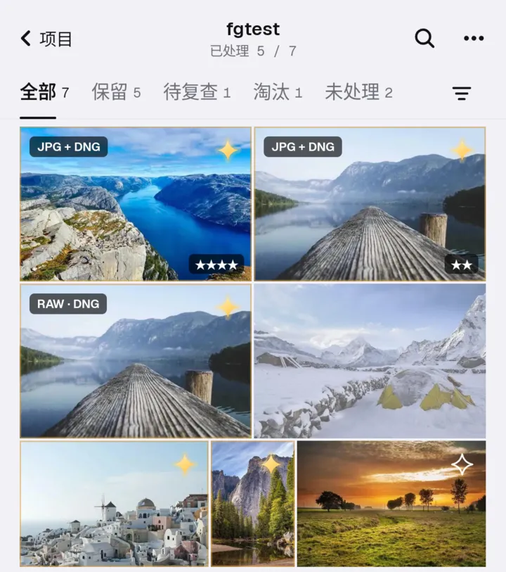
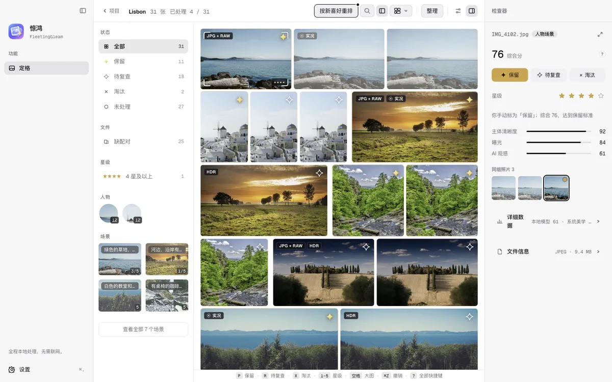
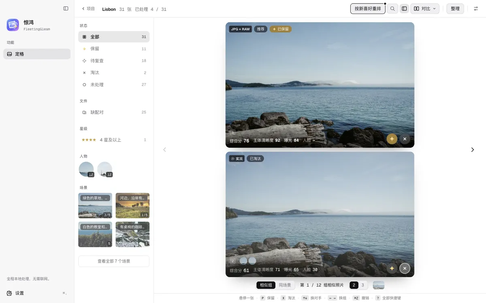

第一个公开版本，Mac 和安卓都有。

### 安卓版来了

和 Mac 用同一套分析核心，分组、场景、取舍结果两端一致；高通手机上 CLIP 跑在 NPU 上。保留的照片导出到相册或任意文件夹，淘汰的进系统回收站，30 天内可以恢复。

### 选片更顺手

- 标题栏显示「已处理 x / N」，筛选面板多了「未处理」。
- 判定后自动跳到下一张，底部常驻一条按键提示。
- 按 1–5 打星，RAW 和同名 JPG 算一张照片一起处理。
- 评分和标记可以写回 Lightroom / Bridge（XMP）。
- 大 RAW 先用相机内嵌的预览，打开不用等。

### 对比时看得更清楚

同组照片上下排开、同步放大，每张都列出综合分、主体清晰度和曝光。分析没跑完就能开始看、开始判定。

### 以后在应用里更新

两端都会自己发现新版本，在「设置 › 关于」里看更新内容、一键下载安装。自动检查可以关掉。

### 其它

- NAS：内置 SMB 客户端直连 NAS，保留的照片可以直接导出到 NAS。
- 备份：「我的设置与喜好」可以备份到你自己的 R2 存储桶，或导出成文件。
- 照片旋转、整理后一次撤销、Mac 菜单全中文，以及大量修复。
