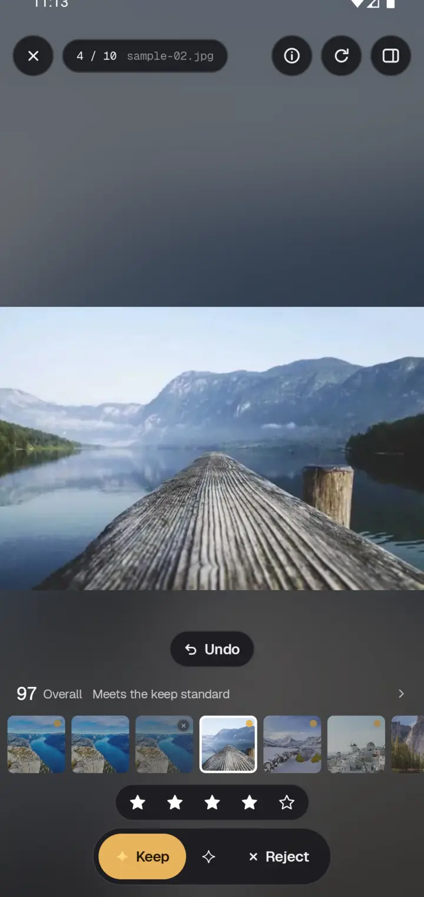
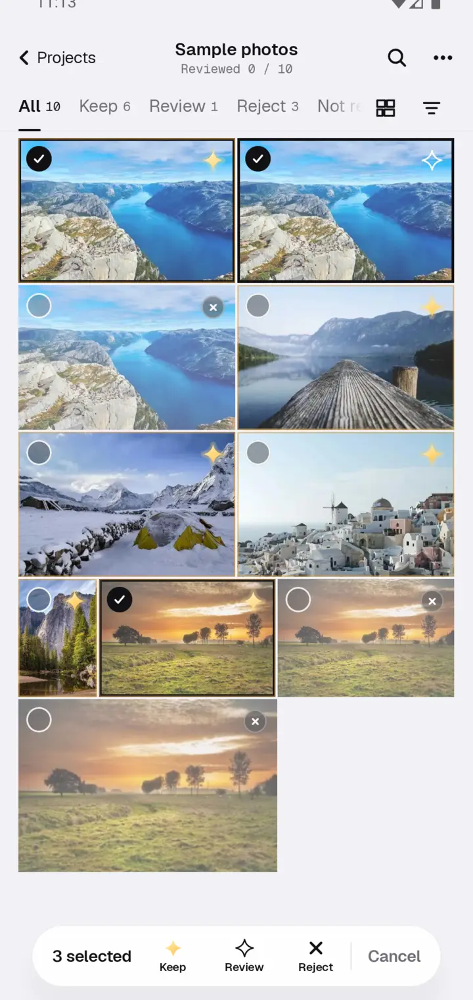
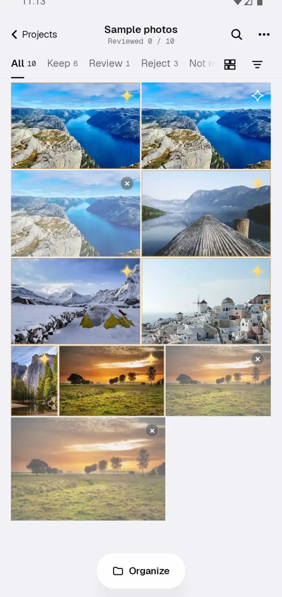

This release straightens out the Android app: one way to mark photos, a first run that shows the whole flow in seconds, and undo for slips.

### One way to mark, and undo

- The viewer shows the overall score and the reason right under the photo; tap it for the details.
- After you mark or rate a photo, Undo floats up; the wall's top bar has an Undo button too.
- The view switcher stays next to the tabs, so the bottom bar never turns into a Reject button under your thumb.
- Single view keeps one set of buttons and can rate; the inspector only explains why.
- Rejected photos carry an × badge in the corner and stay in colour.

### Long-press to select several

Long-press a photo to start selecting, tap others to add them, then keep, review or reject them all at once. One undo puts them back.

### The whole flow in seconds

On the welcome screen, "Try it with sample photos" no longer downloads two hundred megabytes of models first: the analysed wall is there at once. An Organize button now sits at the bottom of the wall for exporting keepers and binning rejects.

### Also

- Ratings belong to kept photos (Mac and Android): rating a photo keeps it, and rejecting or reviewing it clears the rating.
- Update checks read the release's version file, so they work behind a proxy or VPN.
- After choosing "Use the standard model for now", the same dialog lets you switch back to the better one.
- Liquid glass has an Auto setting that follows the phone's performance.
- Fixed a crash when an analysis finished instantly, the settings page not following a language change, and many small layout details.
