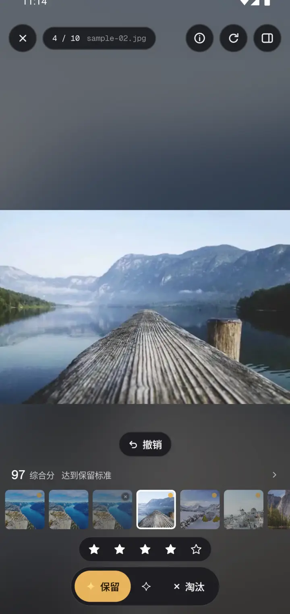
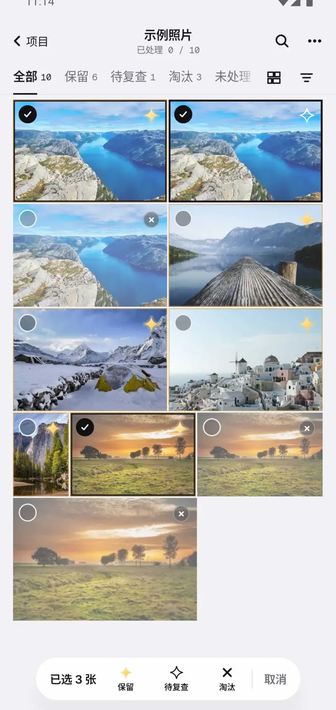
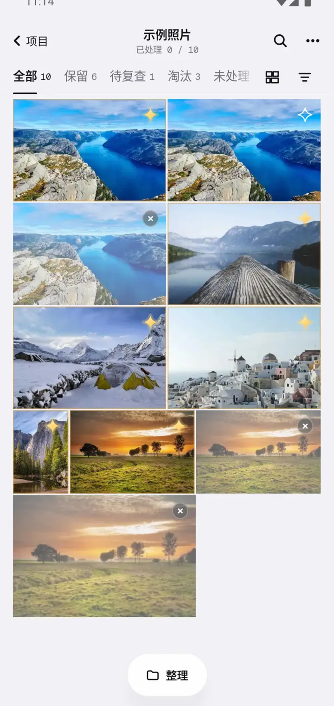

这一版主要是把安卓端理顺：判定只有一套做法，新手打开就能走完一遍，误点了能撤销。

### 判定收成一套，误点能撤销

- 大图底部直接显示综合分和理由，点它看细项。
- 判完或打完星，上方会浮出"撤销"；照片墙顶栏也有撤销按钮。
- 浏览方式按钮固定在页签右边，底栏不会再一会儿是浏览方式、一会儿是淘汰。
- 单张布局只留一套判定，也能打星；检查器只讲"为什么"，不再重复放按钮。
- 淘汰的照片右上角有 × 角标，照片仍是彩色的。

### 长按多选，一批一起判

长按一张进入多选，接着点别的照片勾上，底栏一次保留、待复查或淘汰，算一步撤销。

### 新手几秒走完全程

欢迎页点"用示例照片先试试"，不用再先下载两百多兆模型，马上就是分析好的照片墙。照片墙底部有了"整理"按钮，挑完直接导出或把淘汰的移进回收站。

### 其它

- 星级只属于保留的照片（Mac 和安卓）：打星就是保留，改判淘汰或待复查时星级一起清掉。
- 检查更新改读发布页的版本清单，挂代理或 VPN 时不会总是"没查到"。
- 下载模型时选了"先用标准模型"，还能在同一个框里改回更好的那档。
- 液态玻璃有了"自动"档，按手机性能决定开不开。
- 修了分析瞬间完成时会闪退、切换语言后设置页不刷新等问题，以及一批界面细节。
